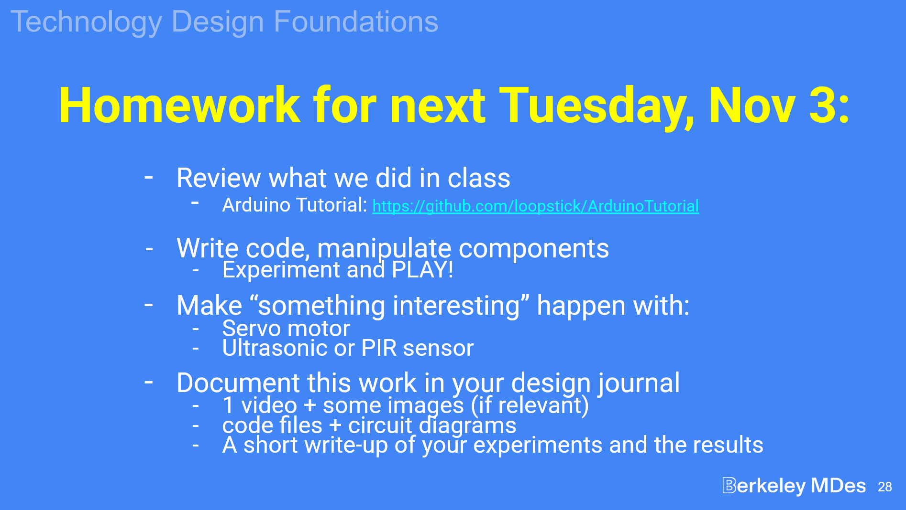
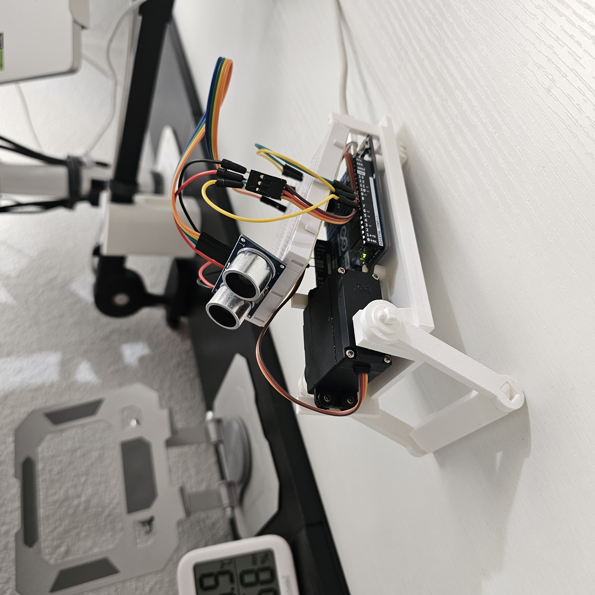
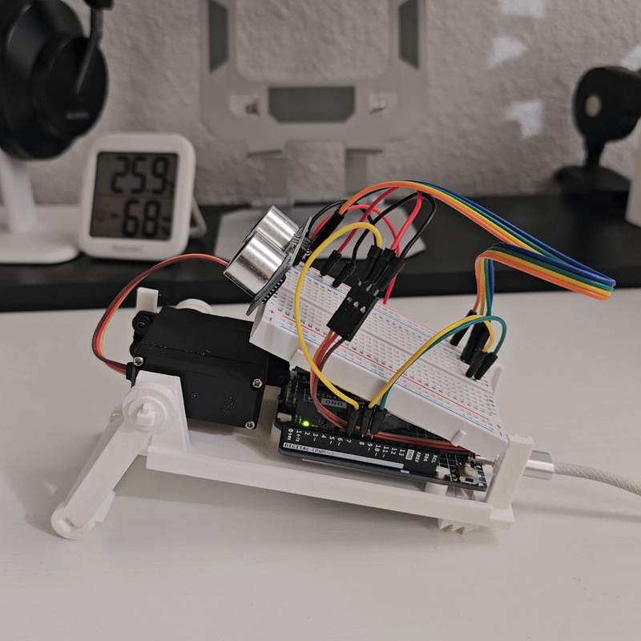

This class we are picking back up Arduino explorations. We needed to make an LED light blink but I will admit that I was too busy using my Arduino to make a Piranha plant cuckoo clock... which should be a pass because it proves I know my stuff with Arduino :)

Links below to some of my Arduino explorations:

[LED Light](https://medium.com/@a368li/combination-lock-potentiometer-d5a84b788fd3)
[LED with Serial](https://medium.com/@a368li/lab-2-led-smoothie-67f13061431f)
[Piranha](https://medium.com/@joyce_kung/lab-8-simple-mechanics-f4ebe2626414?sharedUserId=joyce_kung) 

Note for myself that there are tools in the makerspace that allow for the creation and cutting of custom protoboards.
___
# Homework

For this homework, I want to add a ultrasonic to a previous [crawler](https://medium.com/@a368li/longstride-crawler-a86159cc321b) bot I made, so that the bot will crawl once something is detected in it's rear.

Update!

It was simpler to print a new (albeit much smaller) crawler than to reuse the previous crawler. I also did not account for the angle at which the ultrasonic sensor would be pointing at. So even though I created a dedicated slot for it in the rear, it actually kept detecting the table surface, and I had to mount it near the front instead.

Here's a demo GIF:
