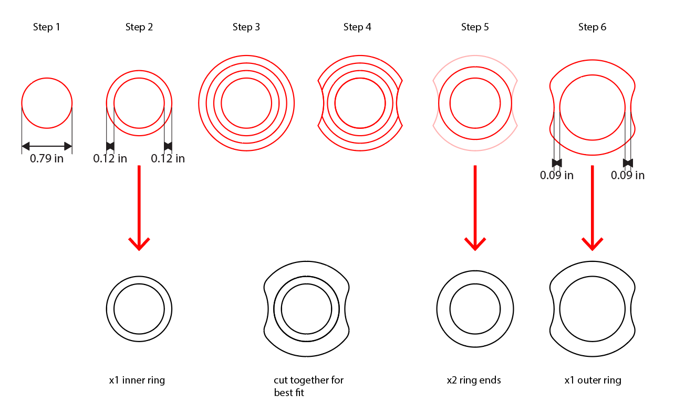
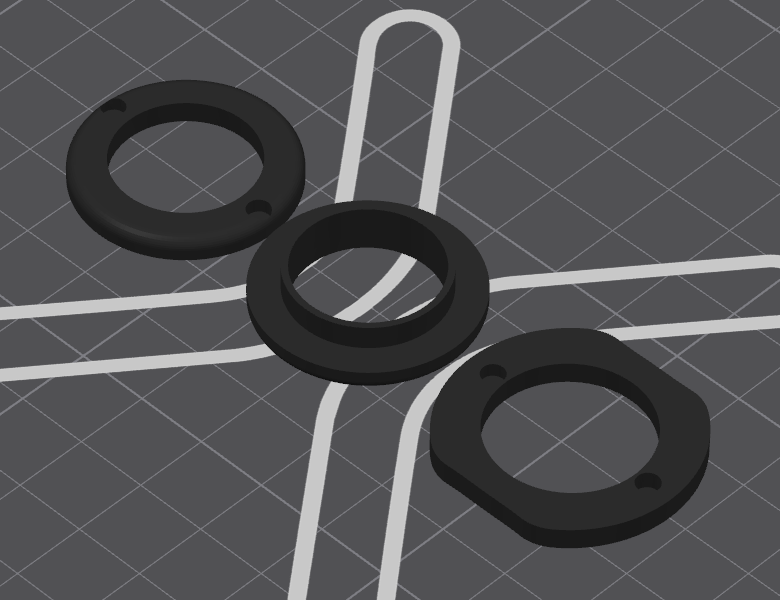

Ring photos!

I drew this out in illustrator, anticipating a minimum thickness of 0.09inches for 1/8th wood, and also cut a couple variations with more thicknesses in case it snapped during sanding.

For the spinner, it made sense to nest the internal ring within the outer ring so the tolerance created by the laser creates the space needed for it to fit well but spin freely!

Works very well :)
![[Screenshot_20261029_160323_Slides.jpg]]

___
Lecture on 3D printing by Chris today. I've been printing since 2015, and consistently for TUI so taking this lecture as a refresher on the basics.

We are to recreate the ring, but mine was designed for flat materials which doesn't make sense to mimic with 3DP.

3D printing allow us to combine different elements/materials. I'm curious as to how a spinner would function if magnets were embedded into the flanges.

Here's the finished print:

Here's a GIF of the spin:
