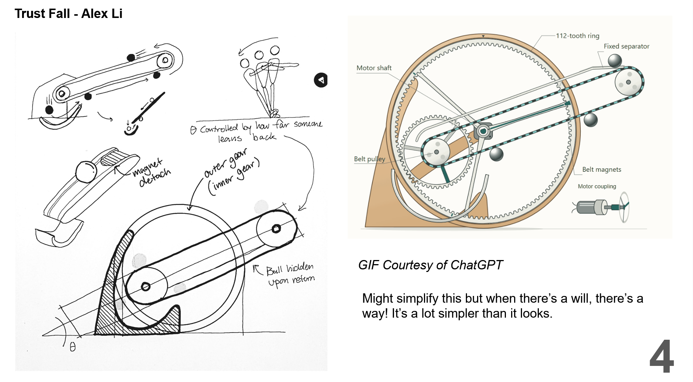

Working on the expressive mechanics sketching today. At home sick while everyone presents their rings (I still got mine onto the slides tho!)

I went through many different concepts, and originally wanted to create some sort of magic trick or impossible illusion, such as using magnets to create levitating parts. However, simplicity and elegance is key + using simple free-fall and gravity to create a captivating mechanism.

The idea I landed on takes inspiration from the "trust fall" and changes the incline angle of a track based on how far back a person leans. The scare which comes from the trust fall is mimicked by the ball actually falling OFF the track, being caught by a ramp and launched to the underside of the track, caught by magnets.

Sounds a lot more complicated than it really is. 

I like the look of wood + white plastic, so the stands and static pieces will be lasercut, while the gears and other moving parts are 3D printed.

