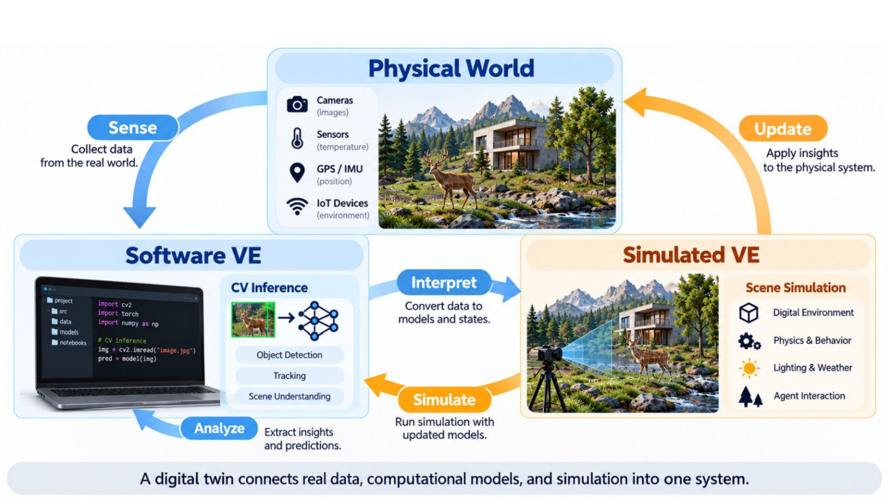

# 2026-09-29 | Week 6

[Our group process PDF](../sources/Chillin-Digiphant-Process-Documentation.pdf) has the photos, diagrams, and longer account of how the project developed.

Joris shared the anti-classifier shirt, maybe it can be a fun party trick in the future.
Today's lecture is on ML methods in computer vision and virtual environments.

I'm familiar with venv/Conda/numPy/PyTorch, so I was assuming we would talk about those types of environments (software), but Joris actually shared Simulated Virtual Environments which I think is very interesting as it's quite literally a virtual **environment** with a real digital world running in Unity/Unreal/etc.

The environment is built by point-clouds, and the goal is to connect the capabilities of agents through software (code, data processing, ML) and then have it communicate with simulated scenes to predict or update information that provides insight to the physical world.

In turn, data collected in the physical world feeds back into the different environments.

The rest of the class was setting up unity, exciting stuff!!

Note: make sure to put the project folder into the same directories that agents have access to. Try to consolidate all agent work into one main folder structure.

Repo: https://github.com/kommanderpi/studentstarter

## Where this led

Looking back from October 14, this was the starting point for connecting our movements to something happening in Unity. We were still learning the basics here. The [Week 6 assignment](Week%206%20Assignment.md) follows how we went from moving the elephant individually to trying it as a group.

*A later photo of Peel Patrol, from p. 4 of the group PDF. We hadn't built all of this on September 29, but it shows where the setup eventually took us.*
