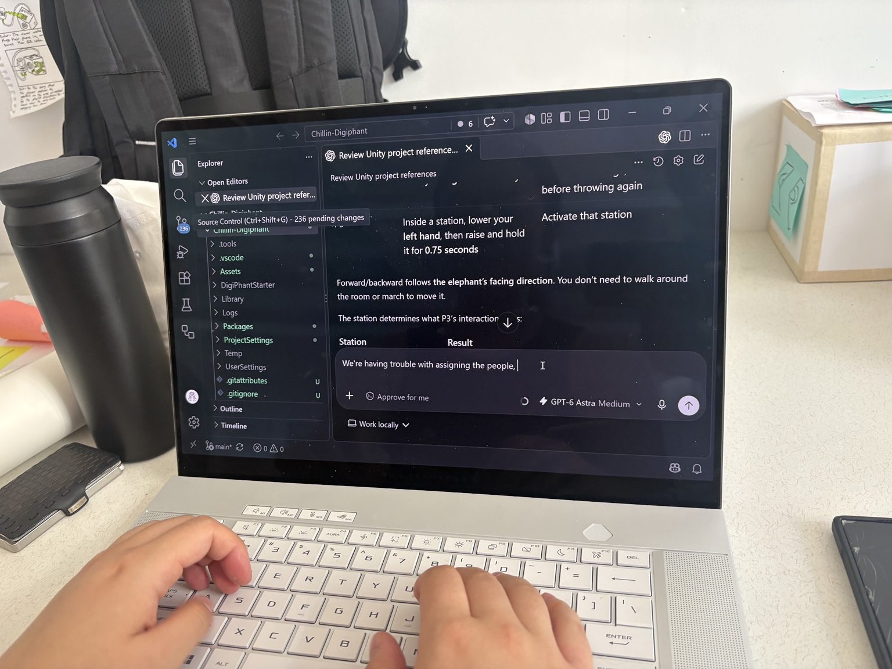

# 2026-10-01 | Week 6

Today we're workshopping.
First, [MediaPipe](https://google-ai-edge.github.io/mediapipe-samples-web/#/vision/face_detector)
Reference: [Slides](https://drive.google.com/drive/u/2/folders/1GPoWKAqtuY81pUT0KkUmKDAWVGAH-YXm)
This weekend I should really learn all the Unity controls...
W to move, E to rotate, typically just the gumball works fine. Note the grey axis is finicky because it aligns to the axis of the camera, which is always changing.

The exercise this week is to connect MediaPipe to the Unity Elephant, and have it move based on MediaPipe inputs. Parts of it is already included in the material Joris provided.

## Process evidence: connecting people to the elephant

*Retrospective annotation added October 14, 2026, from the [Week 6 assignment](Week%206%20Assignment.md) and group process PDF, pp. 4–5.* The workshop goal was to connect MediaPipe inputs to Unity. The later team experiment exposed a specific failure: only two of the three performers were being detected consistently. The response was to wait for three people before assigning roles, introduce separate player regions, and make the preview orientation easier to understand.

*Group process PDF, p. 4. The visible troubleshooting prompt concerns incorrect control assignment. Capture date is not confirmed.*

The PDF reports that Ryanne observed all three people being recognized after the region changes. This is evidence of that reported test, not proof that every later kart control was validated. The important iteration was making person-to-role assignment stable before adding more actions.
