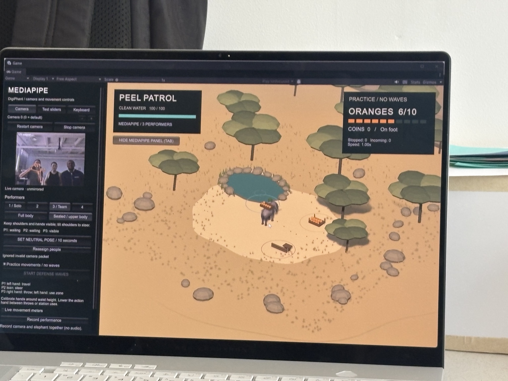
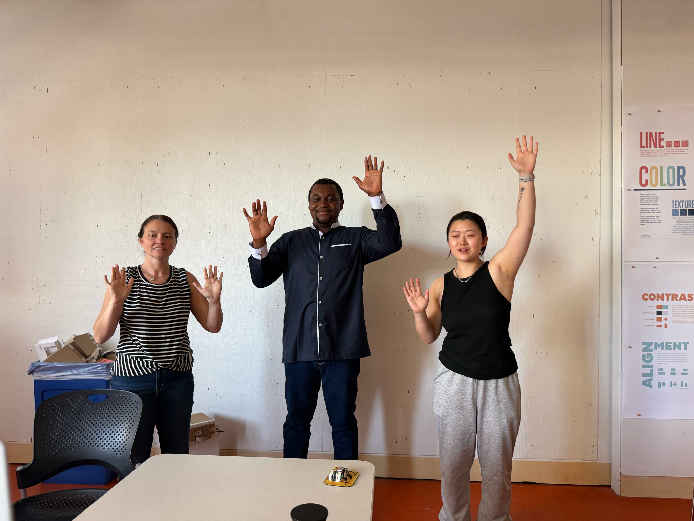

[Our group process PDF](../sources/Chillin-Digiphant-Process-Documentation.pdf) has the photos, diagrams, and longer account of how the project developed.

Weeks 5 and 6 were mostly about learning computer vision through smaller projects and exercises. This is where that started feeding into our group elephant project.

Group name: Just Chillin'
Members: Alex Li, Ryanne Plaisance, Stephen Samuel Kwame Jaja

Assignment is to have the three of us control the elephant through MediaPipe, bonus points for customising the UI, Environments, Elephant appearance, and record a presentation/demo video. There will be a live group presentation/demo on Tuesday.

___

[**Deliverables Timeline:**](https://docs.google.com/document/d/1bNW7N3Ph2mR-pEmKXlPowYEHZ-yo497hTHgmmiV8sNw/edit?tab=t.0)
**Tuesday 6th October:** Describe which additional Mediapipe vision task your team chose to integrate and showcase tests of those tools in action.
**Thursday 8th October:** A first attempt at navigating the procedurally generated obstacle course with your elephant (obstacle course supplied by Instructor team).  
**Tuesday 13th October: Final presentation of Project 2**  
- A brief demonstration of each student's individual control, so viewers can understand who drives which part of the rig.
- A recording of your operationalized elephant navigating the supplied obstacle course.

___

Part 1: Individual movement
Running Joris' repo and following his predefined movements, I was easily able to get the elephant moving! Although the gestures are a little odd, so for the team assignment we'll need to make the poses more intuitive and responsive.

Part 2: Environment!
Before we tested team control, we wanted to create an environment and scenarios for our elephant to interact with so there's purpose to the movement and little milestones for us to work towards.

Thinking of those clickbait mobile game ads (the tower defence type), we wanted our elephant to defend a watering hole from invading bananas by throwing oranges as ammo and building a fort. We added a coin mechanic for upgrades with speed and ammo upgrades etc.

Part 3: Group control
The biggest challenge was getting MediaPipe to detect 3 people consistently. We started off with the pose detector and will explore a combination of different MediaPipe inputs once we get more familiar with the interface. It took a good 3-4 hours to add different strategies for consistent detection and to calibrate movements.

Strategies we implemented:
1. Role assignment does not begin until 3 people are detected in the frame.
2. P1 is always the leftmost person, P3 is the middle person, P2 is the rightmost person.
3. Screen overlay with positional boundaries to ensure everyone is identified within their bounds.
4. A Left/Right side indicator on the screen overlay as the computer camera actually mirrors the left/right position so controls get confusing if we keep yelling directions at each other.

*Our earlier Peel Patrol setup, with the game and camera preview together (group PDF, p. 4).*

*Debugging who was controlling what. Ryanne reported that the separate player regions helped it recognize all three of us (group PDF, p. 4).*

*Trying the gestures together (group PDF, p. 1). These photos were added later; we don't have their exact capture dates.*

We kept changing the controls after this. By the [October 13 version](../Week%208/10132026.md), jumping had moved from a leg lift to P3's peace sign.

Related dated notes: [September 29](09292026.md) · [October 1](10012026.md).
