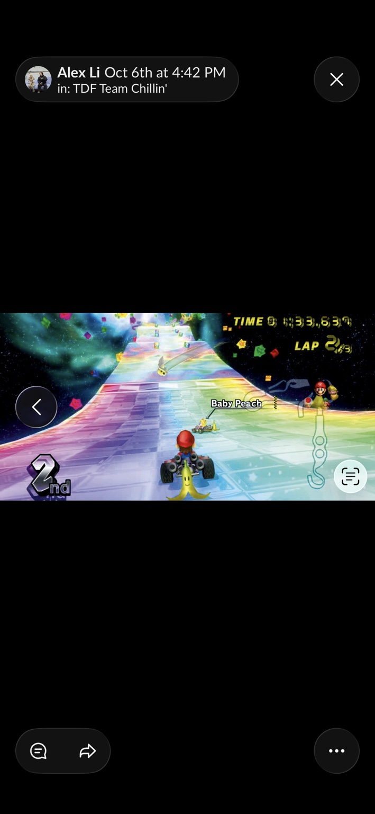

# 2026-10-06 | Week 7

Digital Twins

What is a digital twin (DT)? TJ argues that a DT is any model which can create a representation of the user through data as a way for analysis or projection. For example, a fitbit is actually a digital twin simply by having biometric data that the users finds informative and has access to. The data influences the user.

I haven't thought about it like that before, because I thought it quite literally needed to be a 3D "twin" which is represented both through data and through some form of spatial analysis or representation. Simulations start becoming digital twins within different industries, so it is much more common than I originally thought.

Elements of DT:
1. Live (real) model (RM), typically tracked with sensors.
2. Virtual model (DT).
3. Live data integration/capture between the DT and the RM.
4. Data analysis and simulation.
5. Decisions and optimization.

Essentially:
1. Observe
2. Interpret
3. Translate
4. Simulate

## Project direction: Rainbow Road as a reference

*Retrospective addition on October 14, 2026, based on group process PDF, p. 2.* The PDF identifies this as the Rainbow Road reference I shared on October 6. The racing format gave the supplied obstacle course a clear purpose: players would coordinate movement, steering, and actions to navigate a shared race.

*Mario Kart inspiration, not our Unity game. The original reference capture retains its October 6 label.*

The design direction changed from savanna activities and watering-hole defense to elephant racing. The elephant and cooperative movement stayed central. See the [Week 7 assignment](Week%207%20Assignment.md) for the implementation decisions and the later Unity screenshot.
