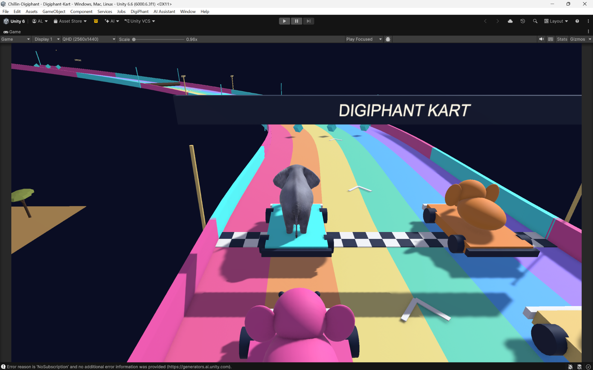

# 2026-10-08 | Week 7

[Our group process PDF](../sources/Chillin-Digiphant-Process-Documentation.pdf) has the photos, diagrams, and longer account of how the project developed.

Signal types:
1. Continuous
	1. Many values within a range
2. Boolean
	1. Only two states (T/F)
3. Discrete/Categorical
	1. Specific states (Open/Half/Closed)

To recap:
Primary outputs of pose landmarkers =
1. Landmark Coordinates
2. Visibility/Confidence
3. Joint Angles
4. Body Orientation
5. Limb Speed
6. Acceleration
7. Pose State

Any combination of the above list can result in the distinction of a specific movement.

## Putting the signals to use

Looking back from October 14, the kart controls are a useful example of these signal types. Steering and acceleration can change by different amounts, crouching is on or off, and a recognized hand gesture can request an action like a throw. The tricky part is bringing everyone's inputs together on the same elephant.

*Where the racing idea ended up in Unity (group PDF, p. 3). This is a later screenshot; its exact capture date wasn't recorded.*

The [Week 7 assignment](Week%207%20Assignment.md) has the list of things we were adding: pickups, colliders, physics, steering, and a camera that follows the player. We kept adjusting the gestures too, so the [October 13 diagram](../Week%208/10132026.md) shows the later controls.
