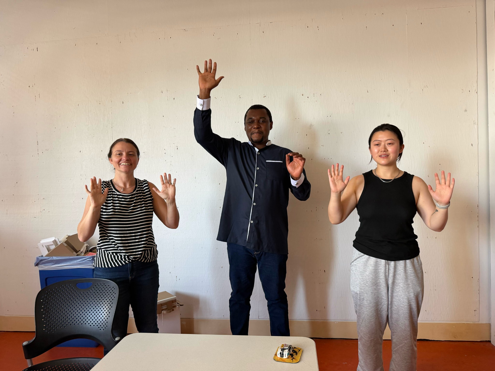
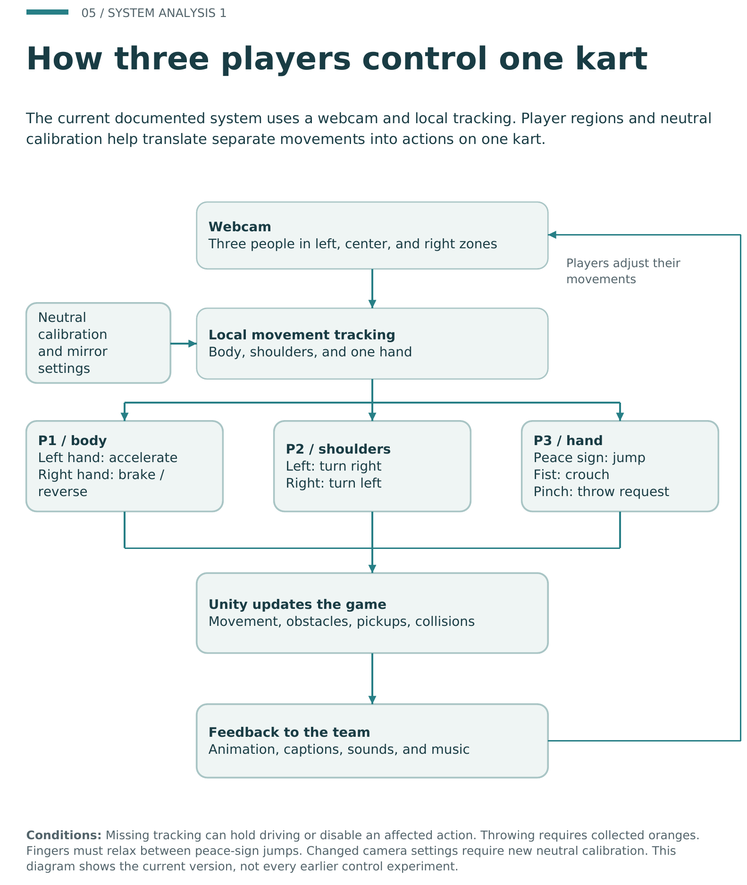
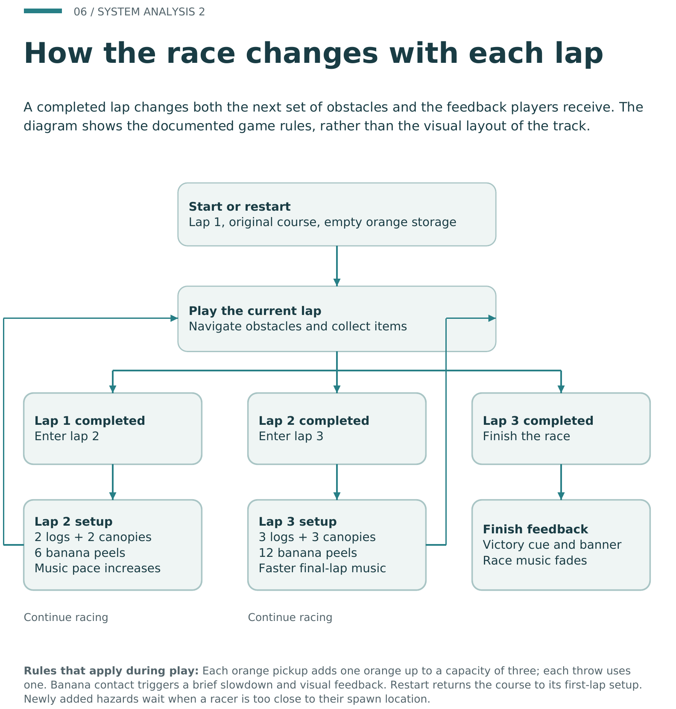

# 2026-10-13 | Week 8

[Our group process PDF](../sources/Chillin-Digiphant-Process-Documentation.pdf) has the photos, diagrams, and longer account of how the project developed.

Today we got together to reflect on the project and work on our final slides, alongside our individual journal entries. There was quite a bit to look back on! Weeks 5 and 6 were mostly smaller projects to learn computer vision, and then we brought that learning into DigiPhant.

We also got some ideas from the other teams' presentations. Some had made custom UI for their cameras and loading screens, which is something we'd like to keep in mind for future projects. We spent a lot of time getting the controls and game working, so it was interesting to see what other teams did with those parts of the interface too.

## Looking back at the game

We went from savanna activities to defending a watering hole in Peel Patrol, and then to racing around Rainbow Road. Racing gave all the movements a purpose: we had to steer, collect oranges, and get past obstacles together. The [Week 6](../Week%206/Week%206%20Assignment.md) and [Week 7](../Week%207/Week%207%20Assignment.md) notes show more of that process.

*Trying the gestures together (group PDF, p. 5). I added the photos and diagrams here on October 14; the exact photo dates weren't recorded.*

Getting all three people recognized was one of the biggest challenges. At first it kept detecting only two of us. Giving everyone a separate region helped, and Ryanne reported that it picked up all three after that change.

Jumping changed a few times too. Physically jumping was unreliable and tiring, so we tried lifting a leg instead. In the later version, the jump moved to P3's peace sign. The older leg-lift controls are still in my Week 7 notes, which shows how much we were adjusting along the way.

## System analysis 1: three players, one kart

*How our inputs reach the game and come back as feedback. Group PDF, p. 6, October 13 version.*

The camera sees three people, but the game needs to know which movements belong to which controls. That's why the player regions and neutral calibration matter. Once the inputs reach Unity, the kart moves and the animation, captions, and sounds let us see what happened. We then adjust our movements and keep going.

| Player | Controls in this version |
| --- | --- |
| P1 / body | Left hand accelerates; right hand brakes or reverses |
| P2 / shoulders | Left shoulder turns right; right shoulder turns left |
| P3 / hand | Peace sign jumps; fist crouches; pinch requests a throw |

There are a few catches. You need an orange before you can throw one, and you have to relax your fingers between peace-sign jumps. If tracking drops out, driving may pause or an action may stop working. Changing the camera setup also means calibrating the neutral pose again. So if the elephant doesn't respond, it isn't always because the gesture was wrong.

## System analysis 2: lap progression and game state

*What changes as the race progresses. Group PDF, p. 7, October 13 version.*

This diagram follows the race rather than the players' movements. Lap one starts with the original course and no oranges. Lap two adds two logs, two canopies, and six banana peels. Lap three has three logs, three canopies, and twelve banana peels. The music speeds up along the way, and finishing the third lap triggers the victory cue and banner.

We can carry up to three oranges, and each throw uses one. Hitting a banana briefly slows the kart down. New hazards wait if a racer is too close to where they would appear, and restarting resets everything to lap one.

The first diagram helps explain how we control the elephant; this one explains what the game does as we play. Both describe the version in our group PDF, rather than a record of every feature being physically tested.

The project [README](https://github.com/al3xxli/Chillin-Digiphant/blob/main/README.md) and [installation guide](https://github.com/al3xxli/Chillin-Digiphant/blob/main/INSTALL.md) have more detail on running it.
